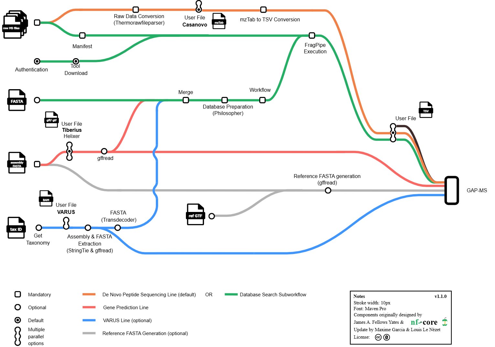

# Proteogenomics Pipeline

[](https://github.com/codespaces/new/qussai96/gap-flow)
[](https://github.com/qussai96/gap-flow/actions/workflows/nf-test.yml)
[](https://github.com/qussai96/gap-flow/actions/workflows/linting.yml)[](https://doi.org/10.5281/zenodo.XXXXXXX)
[](https://www.nf-test.com)

[](https://www.nextflow.io/)
[](https://github.com/nf-core/tools/releases/tag/4.1.0)
[](https://docs.conda.io/en/latest/)
[](https://www.docker.com/)
[](https://sylabs.io/docs/)
[](https://cloud.seqera.io/launch?pipeline=https://github.com/qussai96/gap-flow)

## Introduction
A proteogenomic analysis pipeline for the validation and refinement of genome annotations using peptide evidence derived from mass spectrometry data. It provides an end-to-end workflow integrating peptide identification using [Casanovo](https://proceedings.mlr.press/v162/yilmaz22a.html) or [FragPipe](https://fragpipe.nesvilab.org/), gene prediction using [Tiberius](https://academic.oup.com/bioinformatics/article/doi/10.1093/bioinformatics/btae685/7903281) or [Helixer](https://doi.org/10.1101/2023.02.06.527280), and optional complementary transcriptomic evidence through RNA-seq-guided annotation using [VARUS](https://link.springer.com/article/10.1186/s12859-019-3182-x). The resulting gene models are assessed using [GAP-MS](https://github.com/qussai96/GAP-MS) (Gene model Assessment using Peptides from Mass Spectrometry), which evaluates predicted gene models by integrating outputs from downstream subworkflows.


## Pipeline Configuration and Inputs
The pipeline was developed using Nextflow (version 26.04.4). Singularity is enabled by default as the container runtime and can be changed through the nextflow.config file.

It integrates five subworkflows and a final GAP-MS process, enabling the execution of data preparation, gene prediction, peptide identification and proteogenomic analysis within a single workflow.

The minimum required inputs are raw mass spectrometry data, a genome assembly in FASTA format and an output directory specified using --outdir. The pipeline supports multiple peptide identification approaches, including Casanovo, FragPipe and user-provided peptide identification results in TSV format.

The gene prediction subworkflow generates protein-coding gene models using either Tiberius or Helixer, depending on the selected command-line option. An optional VARUS subworkflow can additionally retrieve publicly available RNA-seq datasets from NCBI and process them to provide transcriptomic evidence for gene model assessment.

Furthermore, the pipeline supports the integration of reference annotations through a user-provided GTF/GFF file. Based on the supplied reference annotation and genome assembly, a corresponding reference protein FASTA file can optionally be generated during workflow execution.

Finally, the GAP-MS process integrates the outputs generated by the preceding workflow components to assess the protein-level support of predicted gene models using peptide evidence and annotation information.

The pipeline also supports alternative execution paths, allowing users to provide precomputed GFF/GTF, BAM, mzTab or TSV files to bypass the corresponding upstream subworkflows, as well as to select between the available gene prediction and peptide identification tools.

Additionally it also includes a reporting workflow incorporating [`MultiQC`](http://multiqc.info/), which generates an HTML report summarizing quality control metrics and other analysis results collected during pipeline execution. 

## Usage
> [!NOTE]
> If you are new to Nextflow and nf-core, please refer to [this page](https://nf-co.re/docs/get_started/environment_setup/overview) on how to set-up Nextflow. Make sure to [test your setup](https://nf-co.re/docs/get_started/run-your-first-pipeline) with `-profile test` before running the workflow on actual data.
 
### Installation 
The pipeline requires Nextflow. Conda can be used to manage the required software environment.

**Miniconda Installation:** 
For more information visit: https://docs.conda.io/projects/conda/en/latest/user-guide/install/index.html
```bash
curl -O https://repo.anaconda.com/miniconda/Miniconda3-latest-Linux-x86_64.sh
bash Miniconda3-latest-Linux-x86_64.sh
```

**Conda setup:**
```bash
conda create -n gapms_pipeline_env -c conda-forge -c bioconda nextflow python=3.11 -y
conda activate gapms_pipeline_env

git clone https://github.com/qussai96/GAP-MS-nextflow.git
cd GAP-MS-nextflow
pip install .
```

### VARUS & TransDecoder Image Creation
To build the TransDecoder Singularity container image, run:
```bash
singularity build transdecoder.sif transdecoder.def
```

To build the VARUS Singularity container image required for the VARUS workflow step, run:
```bash
singularity build varus.sif varus.def
```

### Nextflow config setup
It is possible to change various settings in the nextflow.config file. If needed, the cluster configuration can be modified, including the CPU/GPU and memory resources allocated to individual processes.

### Download of licensed FragPipe components
FragPipe requires the licensed components MSFragger, IonQuant, and DiaTracer. These tools are available free of charge for academic research, non-commercial, and educational use under an academic license. For commercial use, visit [Fragmatics](https://www.fragmatics.com/) or contact info@fragmatics.com. Aditional information is available at the [FragPipe](https://fragpipe.nesvilab.org/docs/tutorial_fragpipe.html) website.

If the licensed components have already been obtained, their location can be provided using the --config_tools_folder parameter.

If the components are not yet available, an automated download process is initiated when the pipeline starts. During this process, the user's first name, last name, academic email address, and institution must be provided. A six-character verification code is then sent by email and must be entered into the terminal. Once the download has completed successfully, the remaining pipeline processes start automatically.

### Running the Pipeline
**Minimal execution**
To run the pipeline with the minimum required inputs:
```bash
nextflow run main.nf \
   --raw_ms_files "/path/to/raw_ms_files_folder" \
   --fasta_file "/path/to/assembly" \
   --outdir <OUTDIR>
```
**Execution with optional parameters**
Additional parameters can be provided to enable specific workflow components and supply supplementary reference data.
For example:
```bash
nextflow run main.nf
   --raw_ms_files "/path/to/raw_ms_files_folder" \
   --fasta_file "/path/to/assembly" \
   --genome_fasta "/path/to/genome_fasta" \
   --ref_gtf "/path/to/ref_gtf" \
   --tax_ID <TAX ID> \
   --genome_option helixer  \
   --peptide_identification fragpipe \
   --ref_fasta true \
   --outdir <OUTDIR>
```

> [!WARNING]
> Please provide pipeline parameters via the CLI or Nextflow `-params-file` option. Custom config files including those provided by the `-c` Nextflow option can be used to provide any configuration _**except for parameters**_; see [docs](https://nf-co.re/docs/running/run-pipelines#using-parameter-files).

## Parameters 
### Required Input Parameters

| Parameter | Description |
| :--- | :--- |
| `--raw_ms_files` | Path to the RAW MS files folder (required) |
| `--genome_fasta` | Path to the genome assembly FASTA file (required) |
| `--outdir` | Specifies the output directory required by the nf-core template. |

---

### Peptide Identification Subworkflow Parameters

| Parameter | Description |
| :--- | :--- |
| `--peptide_identification` | Specifies the peptide identification tool to use or the path to an existing TSV file to skip the peptide identification step (default: `casanovo`). |
| `--peptide_score` | Sets the minimum peptide score threshold for filtering the TSV file in Casanovo (default: `0.8`). |
| `--config_tools_folder` | Path to the folder containing the required FragPipe tools, including MSFragger, IonQuant, and DiaTracer (if available). |
| `--mzTab_casanovo` | Path to a pre-existing mzTab file; if provided, the Casanovo process is skipped. |
| `--add_contaminants` | Enables or disables the addition of contaminants during the decoy generation step in FragPipe (default: `true`). |
| `--fragpipe_workflow` | Path to a custom FragPipe workflow file. |
| `--fasta_file` | Path to the protein FASTA file, which is combined with the protein sequences obtained from the gene prediction output and, optionally, the processed VARUS output in the protein search FragPipe subworkflow. |

---

### Gene Prediction Workflow Subworkflow Parameters

| Parameter | Description |
| :--- | :--- |
| `--genome_option` | Choice of gene prediction tool: Helixer or Tiberius (default: `Tiberius`). |
| `--prediction_gff_file` | Path to a user-provided GFF/GTF file. This parameter can be used instead of `--genome_option` to skip the gene prediction step. |
| `--lineage_helixer` | Helixer lineage model (options: `land_plant`, `fungi`, `vertebrate`, `invertebrate`). |
| `--model_cfg_tiberius` | Tiberius model configuration (options: `angiosperms`, `chlorophyta`, `diatoms`, `fungi`, `insecta`, `mammalia_softmasking_v2`, `mammalia_nosofttmasking_v2`, `mammalia_clamsa_v2`, `vertebrates`). |

---

### VARUS Workflow Subworkflow Parameters

| Parameter | Description |
| :--- | :--- |
| `--taxID` | Taxonomic identifier. If `--taxID` is not specified, the VARUS workflow is skipped and no BAM files are produced. |
| `--rna_seq_bam` | Path to a user-provided BAM file. This parameter can be used instead of `--taxID`. If supplied, VARUS is skipped. |

---

### Reference FASTA Generation Subworkflow Parameters

| Parameter | Description |
| :--- | :--- |
| `--ref_gtf` | Path to user-provided reference GTF file. |
| `--ref_fasta` | Enables the generation of a reference protein FASTA file (default: `false`). |

---

### GAP-MS Process Parameters

| Parameter | Description |
| :--- | :--- |
| `--mapping` | Optional peptide-to-protein mapping file. |
| `--scores` | Optional CSV file with the columns: Protein and external_scor. |
| `--iterative` | Trains an iterative XGBoost model instead of using the pre-trained classifier. |
## Credits

This pipeline was developed by Sonia Błaszczak under the supervision of Qussai Abbas in the research group of Prof. Dr. rer. nat. Dimitrij Frischmann.

<!--We thank the following people for their extensive assistance in the development of this pipeline:-->

## Contributions and Support

If you would like to contribute to this pipeline, please see the [contributing guidelines](docs/CONTRIBUTING.md).

## Citations

<!-- TODO nf-core: Add citation for pipeline after first release. Uncomment lines below and update Zenodo doi and badge at the top of this file. -->
<!-- If you use qussai96/gap-flow for your analysis, please cite it using the following doi: [10.5281/zenodo.XXXXXX](https://doi.org/10.5281/zenodo.XXXXXX) -->

<!-- TODO nf-core: Add bibliography of tools and data used in your pipeline -->

An extensive list of references for the tools used by the pipeline can be found in the [`CITATIONS.md`](CITATIONS.md) file.

This pipeline uses code and infrastructure developed and maintained by the [nf-core](https://nf-co.re) community, reused here under the [MIT license](https://github.com/nf-core/tools/blob/main/LICENSE).

> **The nf-core framework for community-curated bioinformatics pipelines.**
>
> Philip Ewels, Alexander Peltzer, Sven Fillinger, Harshil Patel, Johannes Alneberg, Andreas Wilm, Maxime Ulysse Garcia, Paolo Di Tommaso & Sven Nahnsen.
>
> _Nat Biotechnol._ 2020 Feb 13. doi: [10.1038/s41587-020-0439-x](https://dx.doi.org/10.1038/s41587-020-0439-x).
